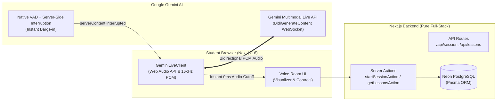

# AI Voice LMS — Real-Time Interactive Voice Learning

A modern web-based Learning Management System (LMS) built with pure Next.js App Router where students learn from an interactive AI Teacher in real time using audio, complete with **sub-second bidirectional streaming** and **instant human interruption (barge-in)**.

---

## 🏗️ Architecture & Technology Stack



### Full-Stack Overview
| Layer | Technology | Description |
|---|---|---|
| **Full-Stack Framework** | Next.js (App Router, Tailwind CSS) | Pure Next.js backend (Server Actions + API routes) & interactive client UI |
| **Database** | Neon Serverless PostgreSQL | Serverless PostgreSQL database |
| **ORM** | Prisma ORM | Schema migrations, typed queries, and relational models |
| **Real-Time Voice AI** | Google Gemini Multimodal Live API | Bidirectional real-time audio with native voice activity detection (VAD) |
| **Audio Engine** | Web Audio API + PCM Streamer | Low-latency 16kHz microphone capture and 24kHz audio buffer playback |

---

## ⚡ Instant Interruption (Barge-in) Architecture

When an AI speaks, traditional voice bots suffer from high latency and inability to handle interruptions. Here, barge-in is achieved with two synchronized layers:

1. **Client-Side VAD (0ms immediate cutoff)**:
   - The browser analyzes microphone input volume continuously.
   - If the student begins speaking while the AI is outputting audio, the browser **instantly purges the playback queue and stops the current audio node immediately**.
2. **Server-Side Interruption**:
   - Google Gemini's server-side VAD detects the student's voice and emits `serverContent.interrupted: true`.
   - The stream halts any in-flight voice generation immediately and seamlessly transitions the conversation context to the student's new speech.

---

## 🚀 Getting Started

### 1. Configure Environment Variables
Ensure `.env` contains your Neon Database URLs and Google Gemini API key:
```env
DATABASE_URL="postgresql://..."
DIRECT_URL="postgresql://..."
GOOGLE_API_KEY="your-gemini-api-key"
NEXT_PUBLIC_APP_URL="http://localhost:3000"
```

### 2. Run Database Migration & Seed
```bash
npm run db:push
npm run db:seed
```

### 3. Start the Next.js App
```bash
npm run dev
```

Open [http://localhost:3000/dashboard](http://localhost:3000/dashboard) in your browser. Choose any lesson, click to join the room, and speak with your AI teacher! No external Python processes or daemons needed.
